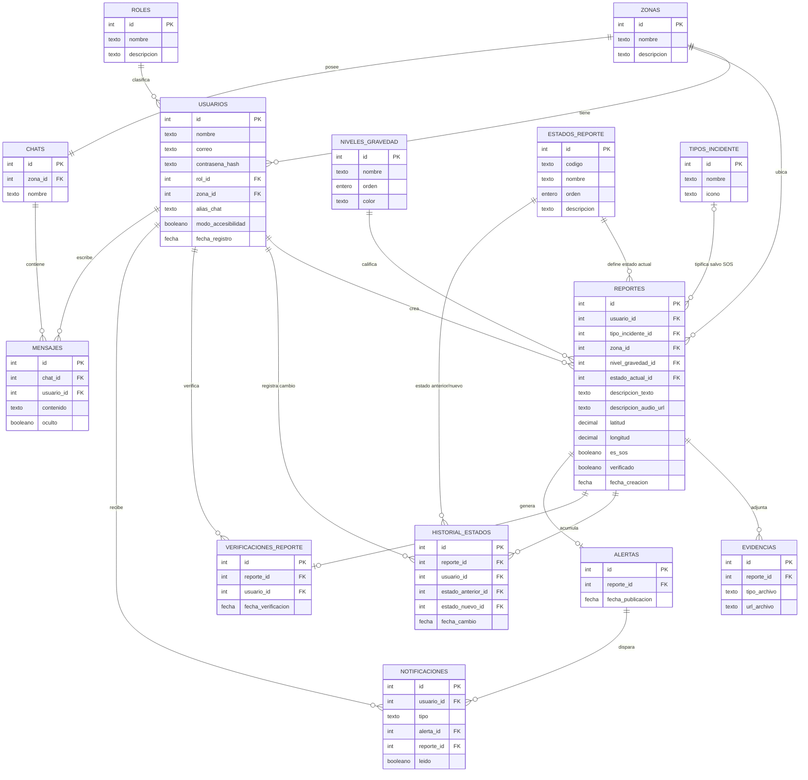

# Diseño de Base de Datos — Los Olivos Conectados

Modelo relacional para PostgreSQL (local). Cada tabla incluye sus columnas, el porqué de cada una, y al final se explican las relaciones y su justificación funcional.

Este documento describe el **modelo objetivo del MVP acordado**. `los_olivos_conectados_schema.sql` crea las tablas y catálogos en una base nueva y vacía; `carga_inicial_villa_sol.sql` añade después la primera zona y su chat. Las decisiones de alcance están en `docs/decisiones-mvp.md`.

**Nota sobre catálogos:** los valores que antes se pensaron como `ENUM` fijos (`rol`, `gravedad`, `estado_actual`) se implementan aquí como **tablas catálogo** (`roles`, `niveles_gravedad`, `estados_reporte`), para poder agregar o modificar valores con un simple `INSERT` en vez de tener que migrar el esquema de la base de datos.

---

## 1. `zonas`

Sectoriza el vecindario. Es la base para el chat por zona, la asignación de usuarios y el filtrado geográfico de reportes.

`zonas` no contiene polígonos ni límites geográficos: el sistema no infiere la zona desde las coordenadas. La zona de residencia es obligatoria para Vecino y Comerciante; la zona del incidente se registra aparte en `reportes`. El modelo admite muchas zonas, cada una con su chat. La carga inicial separada añade Urbanización Villa Sol y `Chat Urbanización Villa Sol`; ni el nombre ni el `id` de esa zona quedan fijados en la lógica.

| Columna | Tipo | Explicación |
| --- | --- | --- |
| `id` | SERIAL PK | Identificador único de la zona. |
| `nombre` | VARCHAR(100) | Nombre visible de la zona (ej. "Sector 4 - Mz. G"). Sirve para mostrarlo en el registro de usuario y en el chat. |
| `descripcion` | TEXT (nullable) | Referencia adicional (límites, avenidas cercanas) para que el equipo sepa a qué área corresponde. |

---

## 2. `roles`

Catálogo de roles del sistema. Reemplaza al ENUM original — si más adelante se necesita un rol nuevo (ej. "dirigente vecinal"), se agrega con un `INSERT`, sin tocar la estructura de `usuarios`.

| Columna | Tipo | Explicación |
| --- | --- | --- |
| `id` | SERIAL PK | Identificador del rol. |
| `nombre` | VARCHAR(50) UNIQUE | Ej. "vecino", "comerciante", "autoridad", "administrador". |
| `descripcion` | TEXT (nullable) | Qué permisos o alcance tiene ese rol, útil como referencia para el equipo. |

---

## 3. `niveles_gravedad`

Catálogo de niveles de gravedad de un reporte. Reemplaza al ENUM original de `gravedad`.

| Columna | Tipo | Explicación |
| --- | --- | --- |
| `id` | SERIAL PK | Identificador del nivel. |
| `nombre` | VARCHAR(30) UNIQUE | Ej. "Baja", "Media", "Alta". |
| `orden` | INTEGER | Permite ordenar de menor a mayor gravedad (ej. 1, 2, 3) para ordenar listas o resaltar visualmente. |
| `color` | VARCHAR(20) (nullable) | Color sugerido para representar ese nivel en el mapa/panel (ej. "#FFC107" para media). |

---

## 4. `estados_reporte`

Catálogo de estados del flujo de un reporte. Reemplaza al ENUM original de `estado_actual`. Es el que más probablemente crezca (ej. agregar "Derivado a otra autoridad"), por eso es el caso más claro para no dejarlo fijo.

| Columna | Tipo | Explicación |
| --- | --- | --- |
| `id` | SERIAL PK | Identificador del estado. |
| `codigo` | VARCHAR(40) NOT NULL UNIQUE | Código estable para API y reglas, por ejemplo `recibido`, `en_revision`, `en_proceso`, `resuelto`. |
| `nombre` | VARCHAR(50) UNIQUE | Ej. "Recibido", "En revisión", "En proceso", "Resuelto". |
| `orden` | INTEGER | Define la posición del estado dentro del flujo (1, 2, 3, 4...), para poder validar en el backend que un reporte no "salte" estados si así se decide. |
| `descripcion` | TEXT (nullable) | Qué significa ese estado para el vecino que hace seguimiento (RF-29), ej. "Un miembro de Serenazgo está revisando tu reporte". |

---

## 5. `usuarios`

Núcleo de identidad. Aunque los reportes se muestren "anónimos" públicamente, todo aquí es identificable — es la base de la trazabilidad interna (RF-03).

| Columna | Tipo | Explicación |
| --- | --- | --- |
| `id` | SERIAL PK | Identificador único del usuario. Es el que vincula internamente cada reporte a su autor real. |
| `nombre` | VARCHAR(150) | Nombre real. No se expone en alertas públicas ni en el chat. Su acceso futuro por Autoridad requiere permisos de gestión definidos. |
| `correo` | VARCHAR(150) UNIQUE NOT NULL | Obligatorio para registro e inicio de sesión en el MVP (RF-01); único para evitar cuentas duplicadas. |
| `telefono` | VARCHAR(20) (nullable) | Opcional; canal alterno de contacto en caso de SOS. |
| `contrasena_hash` | VARCHAR(255) | Hash de contraseña, nunca texto plano (RF-35). RNF-02 se refiere a HTTPS, no al almacenamiento de contraseñas. |
| `rol_id` | INTEGER FK → `roles.id` | El registro público solo permite `vecino` o `comerciante`, inicialmente con iguales permisos. `autoridad` la crea un Administrador vigente; el primer Administrador se crea con el procedimiento privado preparado (RF-04). |
| `zona_id` | INTEGER FK → `zonas.id` | Zona de residencia: obligatoria para Vecino y Comerciante, opcional para Autoridad y Administrador. Determina chat y avisos vecinales; no representa necesariamente la zona de cada incidente. PostgreSQL valida la regla por nombre de rol, sin depender de sus `id`. El registro público también la valida. |
| `alias_chat` | VARCHAR(50) UNIQUE | Alias neutral con código aleatorio para el chat vecinal, independiente del `id`; las cuentas internas pueden tenerlo `NULL` (RF-31). |
| `modo_accesibilidad` | BOOLEAN DEFAULT FALSE | Activa texto grande/alto contraste desde el registro (RF-05). |
| `compromiso_sos_aceptado` | BOOLEAN DEFAULT FALSE | Registra si aceptó el "juramento" de uso responsable del botón SOS al crear la cuenta (RF-13). |
| `consentimiento_privacidad_aceptado` | BOOLEAN DEFAULT FALSE | Registra la aceptación de la política de privacidad (RF-36). |
| `fecha_consentimiento` | TIMESTAMPTZ (nullable) | Instante de aceptación de la política, con zona horaria. |
| `fecha_registro` | TIMESTAMPTZ DEFAULT now() | Auditoría de cuándo se creó la cuenta; la API lo devuelve en UTC. |

El procedimiento privado `backend/scripts/crear-primer-administrador.ts` crea en su primera ejecución la tabla auxiliar `public.inicio_administrador` con una única fila, referencia a la cuenta inicial y fecha. La crea dentro de la misma transacción que la cuenta; su clave primaria y la referencia con `ON DELETE RESTRICT` impiden repetir el alta inicial por el procedimiento, incluso si después cambia el rol de esa cuenta. Esta tabla auxiliar aún no existe en la base principal porque el procedimiento no se ha ejecutado. No forma parte de la carga de zonas ni fija IDs de roles.

---

## 6. `tipos_incidente`

Catálogo cerrado, no texto libre — así el mapa y las estadísticas pueden agrupar y usar íconos consistentes. Ya estaba diseñado como tabla catálogo desde el inicio, siguiendo el mismo criterio que ahora se aplica a rol/gravedad/estado.

| Columna | Tipo | Explicación |
| --- | --- | --- |
| `id` | SERIAL PK | Identificador del tipo. |
| `nombre` | VARCHAR(80) | Ej. "Robo", "Accidente", "Acoso". Es lo que el usuario selecciona en RF-06. |
| `icono` | VARCHAR(100) | Referencia al ícono/marcador que se dibuja en el mapa para ese tipo (RF-26). |

---

## 7. `reportes`

La tabla central del sistema — todo el flujo (reportar → verificar → alertar → seguir) gira en torno a ella.

| Columna | Tipo | Explicación |
| --- | --- | --- |
| `id` | SERIAL PK | Identificador único del reporte. |
| `usuario_id` | INTEGER FK → `usuarios.id` | Autor real del reporte. Nunca se expone públicamente, pero existe para auditoría y para que el propio autor pueda hacer seguimiento (RF-28). |
| `tipo_incidente_id` | INTEGER FK → `tipos_incidente.id` (nullable solo en SOS) | Obligatorio en reportes normales (RF-06); puede quedar vacío cuando `es_sos = true`. |
| `zona_id` | INTEGER NOT NULL FK → `zonas.id` | Zona del incidente. En un reporte normal se propone la de residencia, que el usuario puede corregir; en SOS se toma inicialmente la de la cuenta. Autoridad puede corregirla durante la revisión. No se deduce automáticamente de las coordenadas. |
| `descripcion_texto` | TEXT (nullable) | Descripción escrita del incidente normal (RF-09); puede quedar vacía solo si hay audio o si es SOS. |
| `descripcion_audio_url` | VARCHAR(255) (nullable) | Referencia interna generada por el backend tras recibir el audio por `multipart/form-data`, con forma `privado/reportes-audio/<uuid>.wav`. El archivo se guarda fuera de los recursos HTTP públicos; puede quedar vacía en SOS. La columna conserva su nombre histórico, pero no contiene una URL pública. |
| `latitud` | DECIMAL(10,7) | Coordenada real del incidente, obligatoria para reportes normales y SOS; solo se expone al autor y a cuentas autorizadas. |
| `longitud` | DECIMAL(10,7) | Coordenada real del incidente, con la misma protección que `latitud`. |
| `nivel_gravedad_id` | INTEGER FK → `niveles_gravedad.id` | Permite la vista filtrada de "reportes graves" en el panel de Autoridad (RF-17), sin importar la fecha. |
| `es_sos` | BOOLEAN DEFAULT FALSE | Distingue el SOS del reporte normal. El SOS se crea con gravedad Alta, estado Recibido y prioridad en el panel, sin formulario adicional. |
| `estado_actual_id` | INTEGER FK → `estados_reporte.id` | Estado vigente. El backend seleccionará `recibido` al crear cualquier reporte; PostgreSQL rechaza otro estado inicial y registra automáticamente la primera fila de `historial_estados`. |
| `verificado` | BOOLEAN DEFAULT FALSE | Se activa solo cuando Autoridad lo confirma manualmente (RF-18) — es la condición para generar una alerta pública (RF-20). |
| `fecha_creacion` | TIMESTAMPTZ DEFAULT now() | Instante automático, no editable por el usuario (RF-10); la API lo devuelve en UTC. |

> **Restricción de integridad:** si `es_sos = false`, se exige `tipo_incidente_id` y al menos una descripción no vacía en texto o audio (RF-06, RF-09, RF-11). Si `es_sos = true`, ambos pueden ser `NULL`. Las coordenadas reales y la zona del incidente son obligatorias en ambos casos; PostgreSQL exige gravedad Alta al crear SOS.

> **Nota sobre el valor por defecto:** `estado_actual_id` no tiene un `DEFAULT` fijado en la base de datos, porque Postgres no permite que el valor por defecto de una columna dependa del contenido de otra tabla (en este caso, del id de la fila "Recibido" en `estados_reporte`). Esa asignación la hace el backend explícitamente al insertar un reporte nuevo.

> **Nota de auditoría:** `estado_actual_id` y `verificado` guardan el estado presente. `historial_estados` conserva quién creó el estado inicial y quién cambió estados después. `verificaciones_reporte` conserva quién verificó y cuándo, con una fila única por reporte. Cada cambio y su auditoría deben guardarse juntos en una transacción.

> **Visibilidad:** una alerta pública solo nace tras la verificación. El mapa público muestra un marcador aproximado y estable, cercano a una cuadrícula de 200 m, y la zona; nunca lee públicamente estas coordenadas exactas. El algoritmo de aproximación todavía no está definido.

---

## 8. `evidencias`

Un reporte puede tener varias fotos/audios/videos — por eso es una tabla aparte y no columnas sueltas en `reportes`.

| Columna | Tipo | Explicación |
| --- | --- | --- |
| `id` | SERIAL PK | Identificador de la evidencia. |
| `reporte_id` | INTEGER FK → `reportes.id` | A qué reporte pertenece. |
| `tipo_archivo` | VARCHAR(10) CHECK IN ('foto','audio','video') | Qué tipo de archivo es, para que el frontend sepa cómo renderizarlo. Se deja como CHECK simple. El endpoint de evidencias implementa por ahora `foto` y `video`; el audio descriptivo del reporte se guarda en `reportes.descripcion_audio_url`, y el audio como evidencia posterior queda pendiente. |
| `url_archivo` | VARCHAR(255) | **Referencia interna privada** del archivo, por ejemplo `privado/evidencias/<clave_carga>-<uuid-servidor>.jpg`. No es una URL pública ni una ruta física del servidor. El binario no se guarda en PostgreSQL (RF-07 / RNF-05); el acceso autorizado se realiza mediante `GET /reportes/:id/evidencias/:evidenciaId/archivo`. |
| `fecha_subida` | TIMESTAMPTZ DEFAULT now() | Auditoría de cuándo se adjuntó. |

---

## 9. `historial_estados`

Aquí vive el historial de estados del reporte (RF-19, RF-29). Su primera fila registra `Recibido` y se atribuye al autor que envió el reporte; los cambios posteriores registran a la cuenta de Autoridad o Administrador que los realizó.

| Columna | Tipo | Explicación |
| --- | --- | --- |
| `id` | SERIAL PK | Identificador del registro de auditoría. |
| `reporte_id` | INTEGER FK → `reportes.id` | A qué reporte corresponde este cambio. |
| `usuario_id` | INTEGER FK → `usuarios.id` | Autor del reporte en la fila inicial; Autoridad o Administrador en los cambios posteriores. |
| `estado_anterior_id` | INTEGER FK → `estados_reporte.id` | Estado antes del cambio. |
| `estado_nuevo_id` | INTEGER FK → `estados_reporte.id` | Estado después del cambio. |
| `comentario` | TEXT (nullable) | Justificación opcional que la Autoridad puede dejar al cambiar el estado (útil para el vecino y para auditoría). |
| `fecha_cambio` | TIMESTAMPTZ DEFAULT now() | Instante del registro; junto con `usuario_id`, sustenta la trazabilidad (RF-19, RF-29). |

> Esta tabla es **insertar-solo**: un trigger de PostgreSQL rechaza `UPDATE` y `DELETE`, incluso si la cuenta de la aplicación es dueña de la tabla. Se revocan además esos permisos a `PUBLIC`. El primer registro se inserta automáticamente con el reporte; cada cambio posterior debe guardarse con su fila de historial en una transacción.

## 10. `verificaciones_reporte`

Además de `historial_estados`, una verificación registra el reporte, quién lo verificó y cuándo. Se guarda en la misma transacción que `reportes.verificado = true`, la alerta única y sus avisos internos. La clave única impide verificar dos veces el mismo reporte.

| Columna | Tipo | Explicación |
| --- | --- | --- |
| `id` | SERIAL PK | Identificador del registro. |
| `reporte_id` | INTEGER NOT NULL UNIQUE FK → `reportes.id` | Una sola verificación por reporte. |
| `usuario_id` | INTEGER NOT NULL FK → `usuarios.id` | Cuenta que verificó. |
| `fecha_verificacion` | TIMESTAMPTZ NOT NULL DEFAULT now() | Instante de verificación; la API lo devuelve en UTC. |

---

## 11. `alertas`

Se genera automáticamente cuando un reporte pasa a `verificado = true`. Relación 1:1 con `reportes` porque un reporte verificado genera como máximo una alerta pública.

| Columna | Tipo | Explicación |
| --- | --- | --- |
| `id` | SERIAL PK | Identificador de la alerta. |
| `reporte_id` | INTEGER FK UNIQUE → `reportes.id` | El `UNIQUE` fuerza que un mismo reporte no genere dos alertas duplicadas. |
| `fecha_publicacion` | TIMESTAMPTZ DEFAULT now() | Instante en que se hizo pública, usado para ordenar el feed de RF-22. |

---

## 12. `notificaciones`

Registra avisos **dentro de la aplicación**: cambios de estado al autor (RF-30), SOS a cuentas de Autoridad y alertas verificadas a vecinos de la zona del incidente. Un SOS pendiente no genera alerta pública ni aviso vecinal. El push a dispositivos dentro de un radio exacto (RF-21 original) queda fuera del MVP.

| Columna | Tipo | Explicación |
| --- | --- | --- |
| `id` | SERIAL PK | Identificador de la notificación. |
| `usuario_id` | INTEGER FK → `usuarios.id` | Destinatario. |
| `tipo` | VARCHAR(20) CHECK IN ('alerta','sos','cambio_estado') | `sos`: aviso interno a Autoridad; `alerta`: aviso vecinal por zona tras verificación; `cambio_estado`: aviso al autor. |
| `alerta_id` | INTEGER FK (nullable) → `alertas.id` | Se llena solo si `tipo = 'alerta'`. |
| `reporte_id` | INTEGER FK (nullable) → `reportes.id` | Se llena si `tipo = 'sos'` o `'cambio_estado'`, para poder redirigir al detalle correcto. |
| `leido` | BOOLEAN DEFAULT FALSE | Para mostrar el conteo de notificaciones no leídas en la app. |
| `fecha_envio` | TIMESTAMPTZ DEFAULT now() | Instante en que el aviso quedó registrado; no demuestra recepción o lectura personal. |

> **Restricción de integridad:** `CHECK` que exige `alerta_id` cuando `tipo = 'alerta'`, o `reporte_id` cuando `tipo` es `'sos'`/`'cambio_estado'` — evita notificaciones "huérfanas" sin referencia al evento que las originó.

---

## 13. `chats`

Relación 1:1 con `zonas` — cada zona tiene su propio espacio de conversación (RF-31).

| Columna | Tipo | Explicación |
| --- | --- | --- |
| `id` | SERIAL PK | Identificador del chat. |
| `zona_id` | INTEGER FK UNIQUE → `zonas.id` | `UNIQUE` porque se definió un chat por zona, no varios. |
| `nombre` | VARCHAR(100) | Nombre visible del chat (normalmente el mismo de la zona). |

---

## 14. `mensajes`

| Columna | Tipo | Explicación |
| --- | --- | --- |
| `id` | SERIAL PK | Identificador del mensaje. |
| `chat_id` | INTEGER FK → `chats.id` | A qué chat de zona pertenece. |
| `usuario_id` | INTEGER FK → `usuarios.id` | Autor real — se guarda para moderación interna, aunque en pantalla solo se muestre `alias_chat` (RF-31). |
| `contenido` | TEXT | Texto del mensaje. |
| `oculto` | BOOLEAN DEFAULT FALSE | Se activa cuando el Administrador modera un mensaje reportado (RF-32) — se oculta, no se borra, para mantener evidencia. |
| `reportado` | BOOLEAN DEFAULT FALSE | Marcado por otro usuario como inapropiado, para que el Administrador lo revise (RF-32). |
| `fecha_envio` | TIMESTAMPTZ DEFAULT now() | Orden cronológico del chat. |

---

## Relaciones y su justificación

| Relación | Cardinalidad | Por qué existe |
| --- | --- | --- |
| `zonas` → `usuarios` | 1:N | Cada Vecino o Comerciante tiene una zona de residencia obligatoria; determina chat y avisos internos. |
| `zonas` → `reportes` | 1:N | La zona del incidente puede diferir de la residencia; el usuario la corrige en un reporte normal y Autoridad puede corregirla después. |
| `zonas` → `chats` | 1:1 | Decisión de diseño: un chat por zona, no un chat libre — evita fragmentación y facilita moderación. |
| `roles` → `usuarios` | 1:N | Muchos usuarios comparten un mismo rol; el catálogo permite agregar roles nuevos sin migrar `usuarios`. |
| `niveles_gravedad` → `reportes` | 1:N | Muchos reportes comparten un mismo nivel de gravedad; permite agregar/ajustar niveles (ej. color, orden) sin migrar `reportes`. |
| `estados_reporte` → `reportes` | 1:N | Cada reporte tiene un estado vigente entre varios posibles; el catálogo permite agregar estados nuevos al flujo. |
| `estados_reporte` → `historial_estados` (x2: anterior y nuevo) | 1:N | Cada fila de auditoría referencia dos estados del catálogo (de dónde venía y a dónde fue el reporte). |
| `usuarios` → `reportes` | 1:N | Un usuario puede crear muchos reportes; cada reporte tiene un único autor real, aunque se muestre anónimo. Es la base de RF-03 y RF-28. |
| `usuarios` → `historial_estados` | 1:N | El autor queda ligado a la fila inicial Recibido; una cuenta de Autoridad o Administrador queda ligada a cada cambio posterior (RF-19). |
| `tipos_incidente` → `reportes` | 1:N (opcional en SOS) | Todo reporte normal tiene un tipo; el SOS puede carecer de él. El catálogo agrupa estadísticas y estandariza íconos cuando hay tipo. |
| `reportes` → `evidencias` | 1:N | Un reporte puede tener varias fotos/audios/videos adjuntos; separarlo evita columnas repetidas y permite agregar más evidencia después sin romper el esquema. |
| `reportes` → `historial_estados` | 1:N | Todo reporte tiene una fila inicial Recibido y acumula los cambios posteriores. |
| `reportes` → `verificaciones_reporte` | 1:0..1 | Sólo los reportes verificados tienen un registro único de quién verificó y cuándo. |
| `usuarios` → `verificaciones_reporte` | 1:N | Una cuenta de Autoridad puede verificar varios reportes. |
| `reportes` → `alertas` | 1:1 (opcional) | No todo reporte se convierte en alerta — solo cuando `verificado = true`. La relación es opcional (puede no existir fila en `alertas`) hasta que eso ocurra. |
| `alertas` → `notificaciones` | 1:N | Una alerta verificada genera avisos internos a vecinos de la zona del incidente, sin usar el radio de RF-21. |
| `usuarios` → `notificaciones` | 1:N | Un usuario puede recibir muchas notificaciones (de distintos tipos) a lo largo del tiempo. |
| `chats` → `mensajes` | 1:N | Un chat de zona acumula muchos mensajes de distintos vecinos. |
| `usuarios` → `mensajes` | 1:N | Cada mensaje tiene un autor real identificable internamente, aunque se muestre con alias — necesario para poder moderar sin perder trazabilidad. |

---

## Detalle técnico de claves foráneas (columna → columna)

Estas son las claves foráneas que crea el esquema nuevo, incluidas las de verificación.

| Tabla origen | Columna FK | Tabla.Columna destino |
| --- | --- | --- |
| `usuarios` | `rol_id` | `roles.id` |
| `usuarios` | `zona_id` | `zonas.id` |
| `reportes` | `usuario_id` | `usuarios.id` |
| `reportes` | `tipo_incidente_id` | `tipos_incidente.id` |
| `reportes` | `zona_id` | `zonas.id` |
| `reportes` | `nivel_gravedad_id` | `niveles_gravedad.id` |
| `reportes` | `estado_actual_id` | `estados_reporte.id` |
| `evidencias` | `reporte_id` | `reportes.id` |
| `historial_estados` | `reporte_id` | `reportes.id` |
| `historial_estados` | `usuario_id` | `usuarios.id` |
| `historial_estados` | `estado_anterior_id` | `estados_reporte.id` |
| `historial_estados` | `estado_nuevo_id` | `estados_reporte.id` |
| `verificaciones_reporte` | `reporte_id` (UNIQUE) | `reportes.id` |
| `verificaciones_reporte` | `usuario_id` | `usuarios.id` |
| `alertas` | `reporte_id` (UNIQUE) | `reportes.id` |
| `notificaciones` | `usuario_id` | `usuarios.id` |
| `notificaciones` | `alerta_id` (nullable) | `alertas.id` |
| `notificaciones` | `reporte_id` (nullable) | `reportes.id` |
| `chats` | `zona_id` (UNIQUE) | `zonas.id` |
| `mensajes` | `chat_id` | `chats.id` |
| `mensajes` | `usuario_id` | `usuarios.id` |

> Nota: `historial_estados` tiene **dos** columnas distintas apuntando a la misma tabla destino (`estados_reporte`) — esto es válido y común; cada una cumple un propósito distinto (estado antes vs. estado después del cambio), por eso no se combinan en una sola columna.

---

## Modelo Lógico (independiente del motor de base de datos)

Este diagrama resume las entidades del esquema objetivo del MVP. La zona de residencia y la zona del incidente son relaciones distintas.

El **esquema físico** es `los_olivos_conectados_schema.sql`, preparado para una base nueva y vacía. Después se ejecuta `carga_inicial_villa_sol.sql`. Ninguno de esos archivos se ha ejecutado desde esta revisión.

---

## Notas de implementación para PostgreSQL local

- **Nombre de la base de datos:** `los_olivos_conectados` (minúsculas, `snake_case`, sin espacios ni mayúsculas, siguiendo la misma convención que tablas y columnas).
- `roles`, `niveles_gravedad`, `estados_reporte` y `tipos_incidente` son tablas catálogo — se pueblan con un `INSERT` inicial (seed) al crear la base de datos, y se pueden ampliar después sin migrar el esquema de las tablas que las referencian.
- `evidencias.tipo_archivo` y `notificaciones.tipo` se dejaron como `CHECK` simple (no catálogo) porque son valores técnicos internos del sistema, no datos de negocio que el equipo vaya a necesitar ampliar o editar — ahí sí conviene mantenerlo fijo y simple.
- Todos los instantes de usuarios, reportes, evidencias, historial, verificaciones, alertas, notificaciones y mensajes son `TIMESTAMPTZ`; la API devolverá UTC.
- Se recomienda crear índices en: `reportes(zona_id)`, `reportes(nivel_gravedad_id)`, `reportes(estado_actual_id)`, `reportes(fecha_creacion)`, y `historial_estados(reporte_id)` — son las columnas que se usan constantemente en los filtros del panel de Autoridad (RF-17) y en el mapa.
- Ningún archivo binario (foto/audio/video) se guarda en la base de datos: solo la ruta, como se explicó en `evidencias.url_archivo`.
- `radio_notificacion_metros` no existe en el esquema del MVP. Los avisos vecinales se seleccionan por `reportes.zona_id` y `usuarios.zona_id`, sin fijar una zona concreta.
- La aproximación estable del marcador público (cuadrícula cercana a 200 m) se calcula para la respuesta pública; su algoritmo exacto no está decidido. Las coordenadas reales permanecen protegidas. El mecanismo de actualización sin recarga del panel de Autoridad también sigue pendiente; el modelo solo garantiza el registro del aviso, no su lectura personal.

## Creación de la base nueva

Después de crear la base vacía `los_olivos_conectados` en PostgreSQL, se ejecuta primero `los_olivos_conectados_schema.sql` y luego `carga_inicial_villa_sol.sql`. El segundo script guarda la descripción acordada de Urbanización Villa Sol y el nombre `Chat Urbanización Villa Sol`; obtiene el `id` de la zona al insertarla o consultarla y no impide agregar otras zonas y chats. Si se repite, no duplica esos datos.

La cuenta de aplicación debe ser una cuenta normal de PostgreSQL, sin privilegios de superusuario ni capacidad de desactivar triggers. El backend tendrá que validar zonas, crear verificación, alerta y notificaciones en una misma transacción, y seleccionar destinatarios por zona cuando se implemente.
